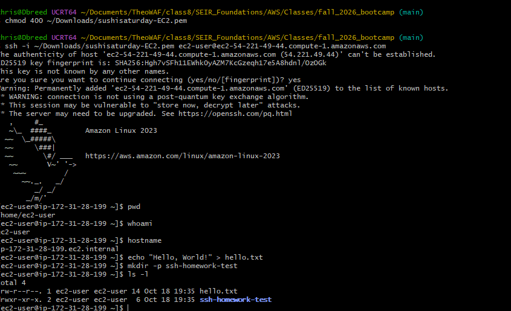
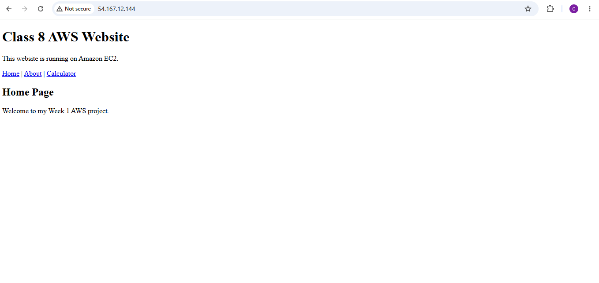
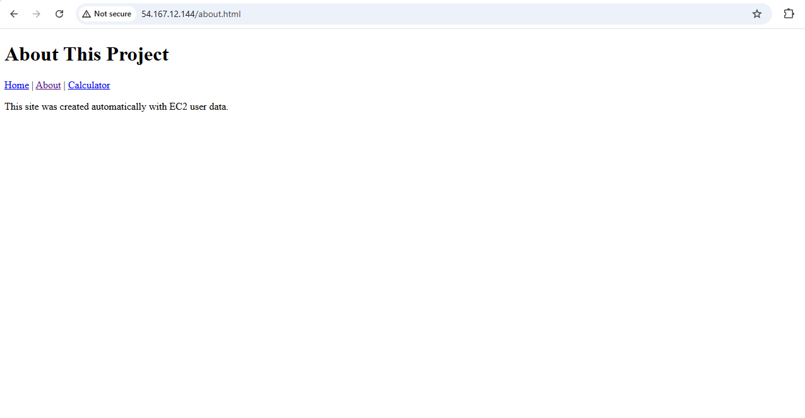
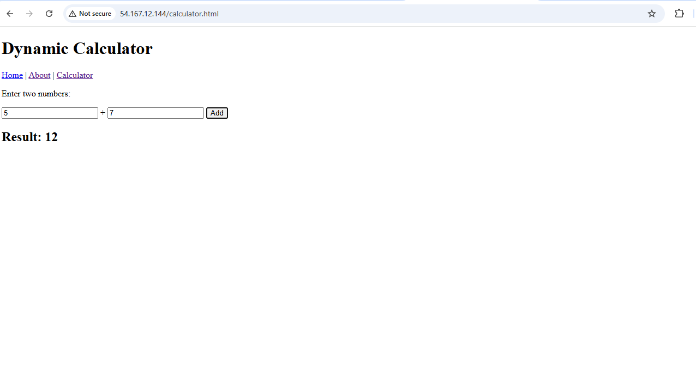
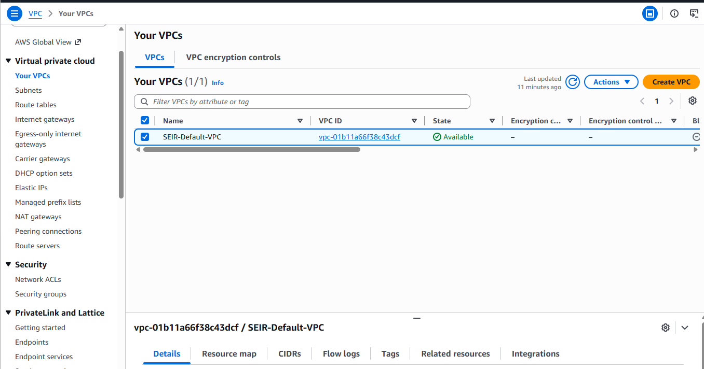
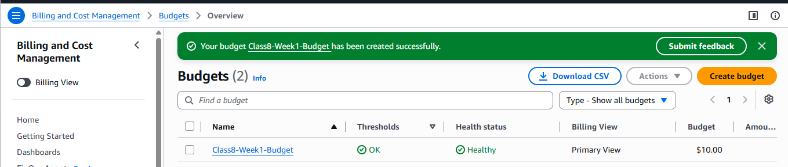
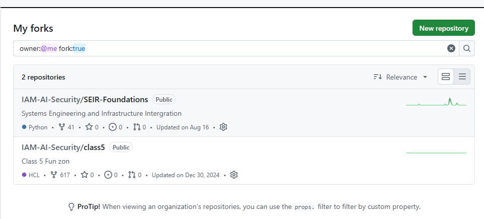

# Week 1 AWS Homework

## Overview

This folder contains my Week 1 AWS homework evidence for Class 8 / SEIR Foundations.

The work demonstrates:

- GitHub repository setup
- SSH connection to Amazon EC2 from Windows Git Bash
- Linux command practice over SSH
- EC2 User Data deployment
- Three-page website hosted on EC2
- Dynamic JavaScript calculator
- Default VPC renamed
- AWS monthly billing budget configured below $20

## EC2 SSH

I connected to an Amazon Linux 2023 EC2 instance from Windows Git Bash using SSH and a PEM key.

Commands demonstrated:

```bash
pwd
whoami
hostname
echo "Hello, World!" > hello.txt
mkdir -p ssh-homework-test
ls -l
```

Evidence:



## EC2 Website

I used an EC2 User Data startup script to install Apache and deploy a three-page website.

The startup script is included in this folder:

`user-data.sh`

### Page 1 - Home



### Page 2 - About



### Page 3 - Dynamic Calculator

The calculator uses JavaScript to add two numbers. The screenshot demonstrates 5 + 7 = 12.



## AWS Account Configuration

### Default VPC

The default VPC in us-east-1 was renamed:

`SEIR-Default-VPC`

Evidence:



### AWS Budget

A monthly AWS budget was created for Week 1.

- Budget name: `Class8-Week1-Budget`
- Budget amount: `$10.00`

Evidence:



## GitHub Setup

Required course repositories were forked into my GitHub account.

Evidence:



## Evidence Files

```text
Week1-AWS/
├── README.md
├── user-data.sh
└── screenshots/
    ├── 01-github-forks.png
    ├── 02-ssh-git-bash.png
    ├── 03-website-home.png
    ├── 04-website-about.png
    ├── 05-website-calculator.png
    ├── 06-default-vpc-renamed.png
    └── 07-aws-budget.png
```
